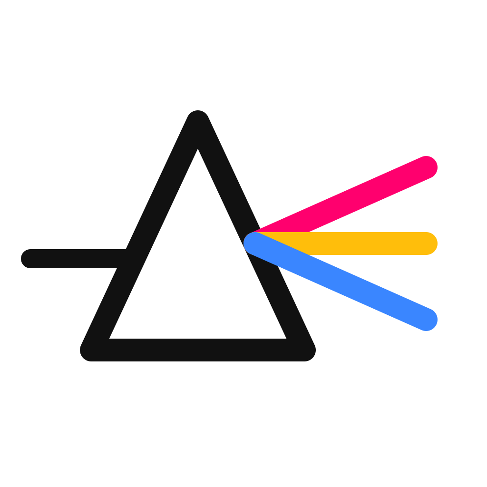
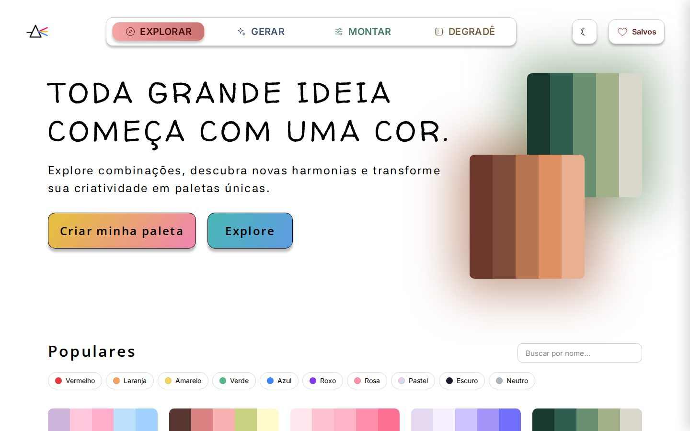
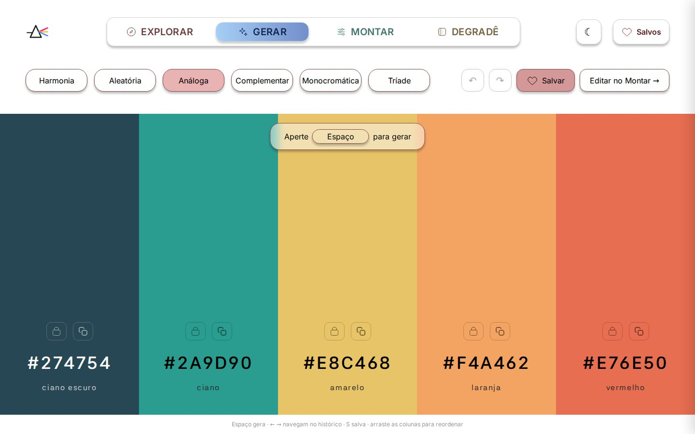
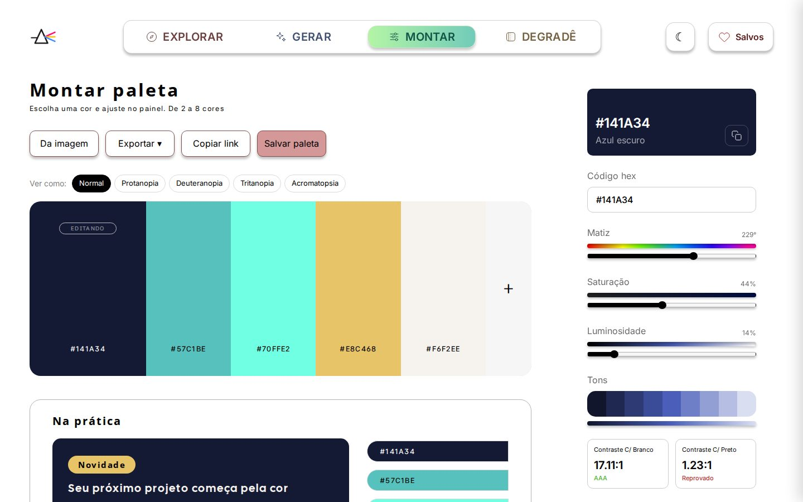
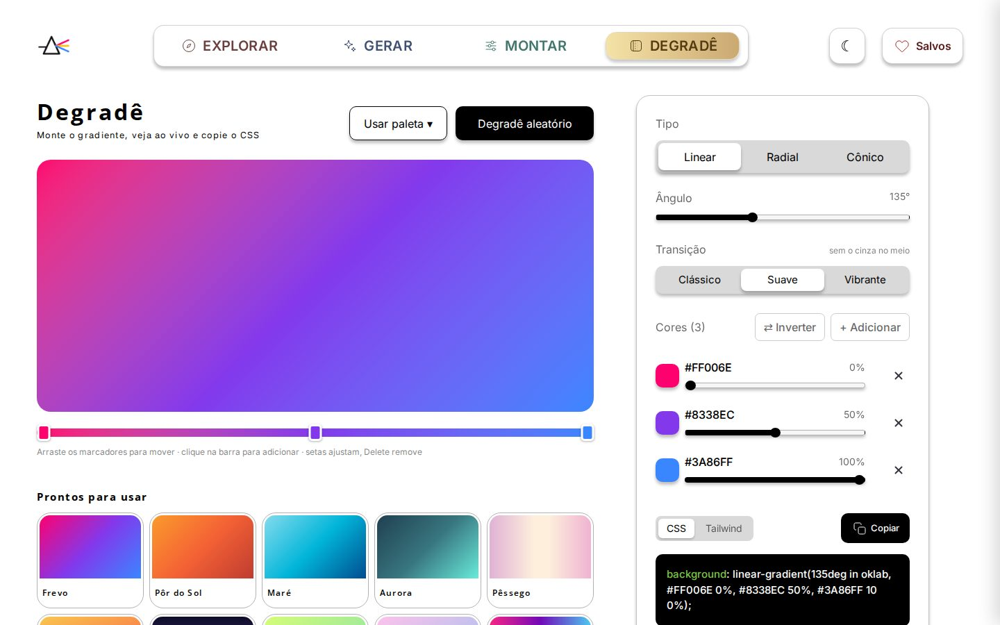
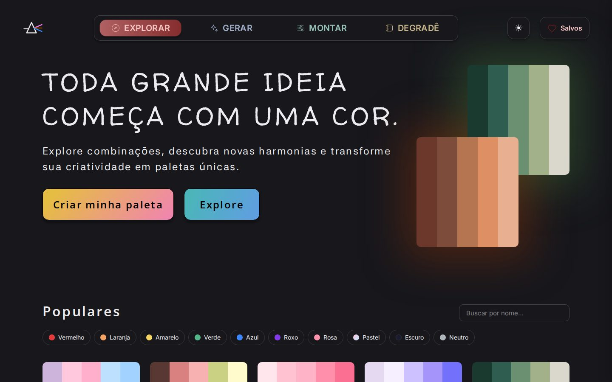

<div align="center">



# HueLab

**Toda grande ideia começa com uma cor.**

Explore combinações, gere harmonias, monte paletas com contraste acessível e crie degradês prontos para usar no seu projeto.

**[Acessar o HueLab →](https://huelab-ruby.vercel.app)**



</div>

## ✨ Funcionalidades

### 🧭 Explorar
- 30 paletas populares, com busca por nome (ignora acentos) e filtro por cor: vermelho, laranja, amarelo, verde, azul, roxo, rosa, pastel, escuro e neutro.
- Passe o mouse numa cor para expandir e clique para copiar o hex.
- Favorite com ♡ e abra qualquer paleta na **página da paleta**, com RGB, HSL, tons, simulação de daltonismo e mapa de contraste.

### ✨ Gerar
- Aperte **Espaço** para gerar paletas nos modos Harmonia, Aleatória, Análoga, Complementar, Monocromática e Tríade.
- **Trave** as cores que você gostou. Elas ficam fixas nas próximas gerações.
- Histórico com **desfazer/refazer** (`Ctrl+Z` / `←` `→`), **salvar** com `S` e arrastar as colunas para reordenar.



### 🎛️ Montar
- Ajuste cada cor por hex, matiz, saturação e luminosidade, ou escolha um tom pronto.
- **Extrair da imagem**: envie, arraste ou cole (`Ctrl+V`) uma foto e o HueLab encontra as cores principais. Clique na imagem para trocar uma cor, como um conta-gotas.
- **Mapa de contraste**: mostra quais pares de cores passam nas regras de acessibilidade WCAG (AA/AAA).
- **Ver como**: simula a paleta para protanopia, deuteranopia, tritanopia e acromatopsia.
- Exporte como **CSS, SCSS, Tailwind v4, JSON ou imagem PNG**, ou copie um link para compartilhar.



### 🌈 Degradê
- Degradês lineares, radiais e cônicos, com ângulo, origem e formato.
- Marcadores arrastáveis: clique na barra para adicionar, use as setas para ajustar e `Delete` para remover.
- Transição **Clássica, Suave (OKLab) ou Vibrante (OKLCH)**, sem o "cinza sujo" no meio do degradê.
- 15 degradês prontos, opção "Usar paleta" e prévia aplicada num card e num botão.
- Copie o CSS ou a classe do Tailwind, baixe em **PNG 1920×1080** ou compartilhe por link.



### 💾 E mais
- **♡ Salvos**: favoritos, paletas e degradês salvos, com renomear e excluir.
- **Backup**: exporte e importe tudo num arquivo JSON. Os salvos ficam só no seu navegador.
- **Modo escuro** ☾, que segue o tema do sistema e lembra a sua escolha.
- Atalhos de teclado `1` a `4` para trocar de tela.

<div align="center">



</div>

## 🛠️ Tecnologias

| | |
|---|---|
| Interface | [React 19](https://react.dev) + [TypeScript](https://www.typescriptlang.org) |
| Build | [Vite](https://vite.dev) |
| Estilo | [Tailwind CSS v4](https://tailwindcss.com) |
| Rotas | [React Router](https://reactrouter.com) |
| Testes | [Vitest](https://vitest.dev) |
| Lint | [Oxlint](https://oxc.rs) |
| Deploy | [Vercel](https://vercel.com) |

Não tem backend: paletas, degradês, favoritos e tema ficam no `localStorage`. As contas de cor (conversões, contraste WCAG, OKLab/OKLCH, extração por k-means e simulação de daltonismo) foram escritas do zero, sem bibliotecas externas.

## 🚀 Rodando localmente

Precisa de [Node.js](https://nodejs.org) 20 ou mais recente.

```bash
git clone https://github.com/guiniwer/huelab.git
cd huelab
npm install
npm run dev
```

Depois, abra [http://localhost:5173](http://localhost:5173).

| Comando | O que faz |
|---|---|
| `npm run dev` | Servidor de desenvolvimento |
| `npm run build` | Checa os tipos e gera a versão de produção em `dist/` |
| `npm run preview` | Serve a versão de produção localmente |
| `npm test` | Roda os testes automáticos |
| `npm run lint` | Procura problemas no código |

## 📁 Estrutura

```
src/
├── pages/          # Telas: Home (Explorar), Gerar, Montar, Degradê e Paleta
├── components/     # Navbar, cards, painel de Salvos, diálogos, mapa de contraste…
│   └── degrade/    # Peças da tela de Degradê
├── lib/
│   ├── color.ts        # Conversões, contraste WCAG, nomes, harmonias, OKLab
│   ├── gradient.ts     # CSS do degradê, classe Tailwind e exportação PNG
│   ├── extract.ts      # Extração de cores de imagens (k-means em OKLab)
│   ├── colorblind.ts   # Simulação de daltonismo
│   ├── share.ts        # Exportações (CSS/SCSS/Tailwind/JSON/PNG) e links
│   ├── storage.ts      # Salvos sincronizados com o localStorage
│   ├── backup.ts       # Exportar/importar backup
│   └── theme.ts        # Tema claro/escuro
├── data/palettes.ts    # Paletas populares e degradês prontos
└── assets/             # Logo e ícones
```

## 🎨 Design

A interface foi desenhada no Figma e implementada a partir dele, com as fontes Walter Turncoat, 42dot Sans, Open Sans, Inter, Cal Sans e Iosevka Charon Mono.
